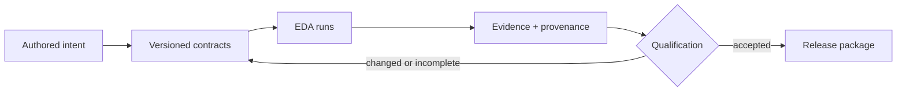

<p align="center">
  
</p>

# ⚡ FlexSoC

**From RTL design intent to defensible engineering evidence.**

FlexSoC is an open-source, Python-based framework for **contract-driven digital hardware development, qualification, and reusable release**. It connects the sources engineers author, the artifacts tools generate, the results they produce, and the decisions required to qualify an IP or SoC.

An EDA tool answers a specific question: *Did lint pass? Did formal prove the property? Did the implementation meet timing?* FlexSoC addresses the harder question across tools and revisions: **Which exact design, constraints and tool configuration produced that answer—and is that evidence still applicable after the design changes?**

FlexSoC **orchestrates rather than replaces** Slang, simulation, formal, synthesis, equivalence, timing, power and physical-design tools. They remain authoritative for their respective analyses. FlexSoC adds explicitly owned inputs, repeatable execution, provenance, stage dependencies, evidence retention and qualification policy through its Python API and `fx` CLI.

### What makes FlexSoC different?

| Challenge | FlexSoC approach | Why it matters |
| --- | --- | --- |
| Disconnected tool runs | Shared run identity, configuration and retained artifacts | An investigation can reconstruct what actually ran |
| Unclear source of truth | Authored/generated boundaries and explicit design contracts | Regeneration need not overwrite hand-authored intent |
| Results become stale | Dependency and provenance-aware evidence lifecycle | A historical PASS is not mistaken for a current qualification |
| Repeated full-flow effort | Selective invalidation of dependent stages | Rerun the gates affected by a change |
| Release lacks traceability | Qualification evidence, metrics and manifests | Review decisions against a known design state |
| IP and SoC scale differently | Reusable core contracts with composition-oriented evolution | Avoids creating unrelated lifecycle models |

### Follow the engineering thread



This is a *conceptual map*, not a claim that every planned SoC-specific capability is already shipped. In particular, the current frozen package commands `fx ip_save` / `fx ip_load` are IP-oriented; extended SoC composition and packaging contracts are a direction of the shared architecture. For exact currently supported operations, consult the [command reference](docs/command_reference.md) and the implementation.

### Where to begin

- **New to FlexSoC?** Start with the [Engineering Handbook](docs/README.md), then run the [Quickstart](docs/quickstart.md).
- **Developing or qualifying an IP?** Follow the [IP development guide](docs/ip_development_guide.md) and [project lifecycle](docs/project_lifecycle.md).
- **Reviewing evidence and release confidence?** Read the [Digital IP Contract](docs/digital_ip_contract.md) and [evidence ownership model](docs/architecture/evidence_ownership.md).
- **Extending the toolchain or viewer?** Read the [architecture](docs/architecture.md), [developer integration guide](docs/developer_integration_guide.md) and [RTL viewer architecture](docs/architecture/rtl_schematic_viewer.md).

## Why FlexSoC

The value of FlexSoC is not proportional to the size of the RTL generator. It comes from making a digital design **reviewable, reproducible, incrementally re-qualifiable, and releasable** while several independent EDA tools operate on it. The same model scales by composition:

- **IP** — a peripheral, register block, arithmetic unit, or small datapath can have a concise contract and a bounded qualification flow.
- **Complex IP** — accelerators, protocol engines, DMA-style blocks, and multi-clock subsystems add richer CDC/RDC, formal, performance, timing, and implementation evidence without changing the core lifecycle model.
- **SoC** — IP composition, address space, interconnect, clocks/resets, software-visible integration, and system verification become first-class design intent connected to the same provenance and qualification graph.
- **Complex SoC** — hierarchy, multiple clock/reset domains, reusable subsystems, multiple technology branches, and partial re-qualification remain manageable because invalidation follows actual dependencies rather than rerunning everything by habit.

A hardware change rarely affects only one file. Adding a status register can
change CSR configuration file (HJSON), generated register RTL, the Python CSR API,
model behavior, tests, formal properties, synthesis, and software-visible documentation.
Adding a clock domain changes constraints, testbench timing, formal assumptions, CDC/RDC
requirements, reset integration, and implementation closure.

FlexSoC makes those dependencies explicit:

- authored sources stay separate from generated collateral;
- bootstrap clock/reset settings initialize one authored `constraints/<TOP>.sdc`; after that the SDC is the timing source of truth;
- Slang resolves the reachable RTL hierarchy and produces ordered filelists;
- the same scenario/model intent can drive SystemVerilog and cocotb environments;
- functional coverage, property proof, and RTL/netlist equivalence remain separate evidence classes;
- synthesis, STA, SDF, power, and OpenROAD runs share one logical run identity;
- raw evidence is normalized into analysis JSON and one `metrics.json` snapshot;
- failed runs retain logs and tool workspaces for diagnosis.

The final goal is a repeatable path from a requirement to evidence that the implemented hardware still matches its specification and design intent, whether the release unit is an IP, a subsystem, or an SoC. The concise
contract, provenance, invalidation, evidence and L1-L5 qualification model is defined
in [`docs/digital_ip_contract.md`](docs/digital_ip_contract.md).

## Main capabilities

### IP definition and generation

- HJSON register specifications;
- register RTL and documentation generation;
- generated Python CSR/regmap API;
- editable RTL core plus generated top wrapper;
- single-clock and arbitrary N-clock configuration;
- per-domain asynchronous-assert/synchronous-release reset integration;
- authoritative `spec/` requirements/test-plan shared across register interfaces;
- reusable interface releases under `hw/ips/<top>/<version>/interfaces/<REG_ITF>/`, with explicit qualification levels and multi-PDK evidence.

### Design verification

- editable Python reference model;
- scenario-based vector generation;
- SystemVerilog and cocotb execution;
- Verilator code coverage;
- automatic CSR formal checks;
- authored assertions and covers through SymbiYosys;
- custom structural CDC/RDC, protocol, reset, and glitch analysis;
- waveform, log, counterexample, and filtered `--debug` inspection.

### Implementation and sign-off

- one authored SDC timing contract shared by DV, CDC/RDC, synthesis setup, implementation, and STA;
- Yosys synthesis with drive/load collateral derived from that SDC;
- EQY RTL-to-mapped-netlist equivalence;
- post-synthesis and post-implementation gate-level simulation;
- SDF generation;
- OpenSTA timing and power analysis;
- OpenROAD physical implementation;
- normalized metrics, manifests, and a colored lifecycle `fx check` dashboard.

CDC/RDC analysis is an explicit post-lint/post-SDC lifecycle gate. DFT insertion
and final foundry physical verification remain separate later-stage gates; none
substitutes for functional verification or formal equivalence.

## Install and run the toolchain

The Python package alone is **not** the complete ASIC environment. `uv sync`
installs FlexSoC and its Python dependencies, but full lint/formal/synthesis/STA/
GLS/OpenROAD flows also require the pinned EDA toolchain.

For normal full-flow use, the recommended path is the immutable Docker image
recorded in `docker/ci/image.lock`.

Clone the repository, then resolve and pull the exact verified image:

```bash
IMAGE_REF="$(bash -lc 'source docker/scripts/common.sh; validate_lock')"
docker pull "$IMAGE_REF"
```

Open an interactive development shell with the current checkout mounted at
`/workspace`:

```bash
docker run --rm -it \
  --pull=missing \
  --volume "$PWD:/workspace" \
  --workdir /workspace \
  --env PYTHONPATH=src \
  --env DEPS_MODE=system \
  "$IMAGE_REF" \
  bash
```

Inside the container, bind the current source tree and verify the environment:

```bash
uv pip install --python "$VIRTUAL_ENV/bin/python" --no-deps --editable .
fx deps-doctor
fx doctor
fx --help
```

A host installation is still useful for Python/API/documentation development:

```bash
uv sync
source .venv/bin/activate
```

but a host can run the complete ASIC flow only when the matching EDA toolchain is
already installed and `fx doctor` reports it ready. Image build/publish details
belong in [docker/README.md](docker/README.md).

## Minimal single-clock flow

Persist project intent once with `fx settings`; normal commands then reuse `TOP`, `RUN_ID`, `REG_ITF`, qualification target, selected PDK, and derived run paths instead of requiring them on every invocation. Explicit `--workdir` overrides are useful for isolated tests/E2E workspaces, not as the normal user experience.

```bash
fx settings \
  TOP=my_ip RUN_TOP=my_ip RUN_ID=dev HOST=uart \
  N_CLOCKS=1 \
  CLOCK_DOMAINS=core:clk_i:rst_ni:10:low \
  CLOCK_RELATIONSHIPS=

fx setup --force
fx hjson reg doc rtl_stub top_from_core flist --force
fx lint

# Initialize once, then review/edit as authored timing intent.
fx sdc --setup --force
# edit constraints/my_ip.sdc

fx cdc_rdc --setup --force
fx cdc_rdc

fx model --setup --force
fx tests_gen --force
fx tb cocotb --setup --force
fx regression
fx coverage --summary
fx coverage --show

fx formal --setup --force
fx formal

fx pdk use sky130
fx syn --setup
fx syn

# Current scaffold baseline: generate EQY collateral only.
# EQY setup is not equivalence PASS and therefore does not satisfy L3.
fx eqy --setup
# Run explicitly only when this IP/interface EQY profile is ready.
fx eqy

fx signoff --setup
fx sdf
fx sta
fx power-estimate

fx manifest
fx metrics
fx check
fx qualify
fx ip_save
```

`fx sdc --setup` is the handoff from bootstrap settings to authored timing intent.
Functional SV/cocotb clocks, CDC/RDC clock relationships, synthesis drive/load
setup, implementation, and STA all consume the same `constraints/<TOP>.sdc`.
Functional clocks honor SDC waveform and source latency and model clock
uncertainty as bounded reproducible jitter using the run `SEED`.

`fx metrics` writes the normalized snapshot to `meta/<pdk>/metrics.json`.
`fx check` reads that saved snapshot and renders the colored lifecycle dashboard;
it does not recollect or modify metrics.

## Minimal N-clock configuration

```bash
fx settings \
  TOP=tri_stream_dsp RUN_TOP=tri_stream_dsp RUN_ID=dev HOST=uart \
  N_CLOCKS=3 \
  'CLOCK_DOMAINS=cfg:cfg_clk_i:cfg_rst_ni:10:low,rx:rx_clk_i:rx_rst_ni:8:low,dsp:dsp_clk_i:dsp_rst_ni:6:low' \
  'CLOCK_RELATIONSHIPS=async:cfg:rx,async:cfg:dsp,async:rx:dsp'
```

The command vocabulary remains the same for one or many clocks. Bootstrap
metadata initializes the first SDC and retains reset ownership/polarity. Once
`constraints/tri_stream_dsp.sdc` exists, edit clock timing and relationships
there rather than maintaining a parallel timing configuration. `top_from_core`
adds one domain-local reset synchronizer per clock/reset domain using the common
`prim_ff_2sync` primitive.

## Development principles

1. Edit the real source of truth.
2. Regenerate only the derived boundary that became stale.
3. Preserve authored RTL, model, tests, properties, and timing intent.
4. Rerun every quality gate whose assumptions changed.
5. Treat lint, CDC/RDC, simulation, coverage, proof, equivalence, timing, power, and physical closure as different evidence.
6. Prefer few complete artifacts over many overlapping reports.
7. Release only from a reproducible run with retained configuration, provenance, metrics, and manifest.

## Documentation

**[Start with the FlexSoC Engineering Handbook](docs/README.md)** — understand why FlexSoC exists, choose a guided reading path, and navigate concepts, engineering workflows, architecture, and exact reference material.

- [Quickstart](docs/quickstart.md) — run the first guided IP workflow.
- [Project lifecycle](docs/project_lifecycle.md) — understand intent, qualification and evidence freshness.
- [Digital IP Contract](docs/digital_ip_contract.md) — explore the reusable design and release model.
- [IP development guide](docs/ip_development_guide.md) — follow the complete implementation and qualification procedure.
- [Architecture](docs/architecture.md) — understand ownership and execution boundaries.
- [Command reference](docs/command_reference.md) — look up exact `fx` command behavior.

## Run layout

A run is isolated by `RUN_TOP` and `RUN_ID`:

```text
<WORKDIR>/runs/<RUN_TOP>/<RUN_ID>/
├── csr/                   canonical CSR/register specifications
│   └── systemrdl/         generated SystemRDL views
├── rtl/                   RTL and ordered filelists
├── doc/                   generated register documentation
├── constraints/<TOP>.sdc  authored timing contract
├── dv/                    functional and property-formal collateral
├── analysis/
│   ├── slang/             parsing/elaboration artifacts
│   ├── lint/
│   │   ├── slang/
│   │   └── verilator/
│   └── cdc_rdc/           structural CDC/RDC evidence
├── syn/<pdk>/             synthesis branch
├── impl/<pdk>/            physical implementation branch
├── signoff/<pdk>/         qualification evidence
│   ├── post_syn/          sta / power / fusion on synthesized netlist
│   └── post_impl/          sta / power / fusion + physical checks after PnR
├── logs/                  raw command/tool logs
└── meta/
    ├── design_intent.json
    └── <pdk>/             settings/provenance/manifest/metrics
```

## API and end-to-end regression

Run the public API/CLI contract tests:

```bash
uv run pytest -q tests/regression/test_api.py
```

Run complete generated flows:

```bash
uv run pytest -s tests/e2e/test_fx.py --e2e-mode full
```

Retain E2E workspaces while debugging:

```bash
uv run pytest -s tests/e2e/test_fx.py --e2e-mode full --e2e-root ~/flexsoc-e2e
```

Stop after formal checks:

```bash
uv run pytest -s tests/e2e/test_fx.py --e2e-mode formal --e2e-root ~/flexsoc-e2e
```

Run through synthesis/post-synthesis sign-off and stop before PnR:

```bash
uv run pytest -s tests/e2e/test_fx.py --e2e-mode pre-pnr --e2e-root ~/flexsoc-e2e
```
