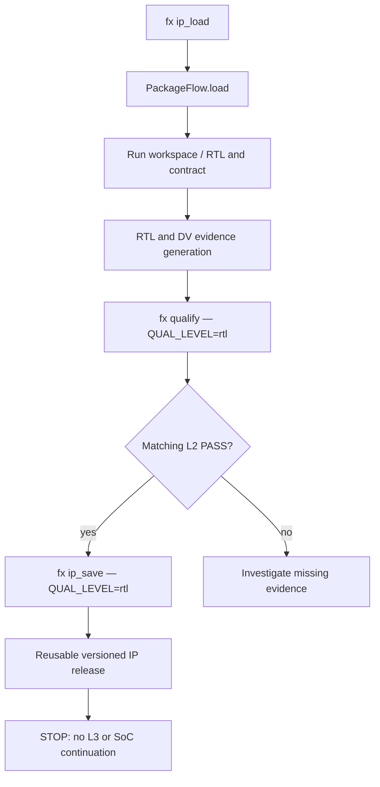

# FlexSoC — Backend audit and development roadmap

> Status: **initial evidence-based inventory** (2026-10-22). Not a completed end-to-end audit or L2 qualification run. This is a new planning/audit document; existing `docs/` content is unchanged.

## Scope and immediate priority

The initial IP validation matrix is:

| IP | Package version present | Interface in initial scope | Notes |
|---|---|---|---|
| `uart` | `1.0.0` | `tlul` | Full selected package / L2 flow |
| `gpio` | `1.0.0` | `tlul` | Full selected package / L2 flow |
| `rv_timer` | `1.0.0` | `tlul` | Full selected package / L2 flow |
| `uart_master` | `1.0.0` | `tlul` (`reg_itf`) | Only the TL-UL register interface; no other interface variants |
| `ethernet` | `0.1.0` | `tlul` | Only TL-UL interface; exclude full Ethernet functional closure for now |

`tlul` is the on-disk interface folder and `REG_ITF=tlul` is the CLI setting. Treat `reg_itf` as a reference to the register-interface selection, **not** as an alternative folder name in this scope. Avoid silently expanding UART/GPIO/timer scope to `reg_iface` or `axi_lite`. For the last two IPs, do not claim full functional L2 qualification when only interface-specific evidence has been exercised; identify any gaps in formal L2 policy.

## Repository snapshot / architecture AS-IS

Source: uploaded ZIP `flexsoc-main(20261022-193507).zip` copied into an isolated workspace. The archive does not include `.git` history. A new **local-only** Git baseline is used to track the inspection and documentation; its commit SHA is not the SHA of the user's repository.

| Component | Implementation entry | Observed responsibility |
|---|---|---|
| CLI | `src/flexsoc/cli.py` | `fx` / `flexsoc` commands and user options |
| API command registry | `src/flexsoc/api.py` | Targets, CLI-facing command descriptions and dispatch metadata |
| Backend context / orchestration | `src/flexsoc/backend/backend.py`, `backend/core/` | Backend wiring, runtime and flow target dispatch |
| Package load / save | `src/flexsoc/backend/release/package.py`, `PackageFlow` | Import frozen IP release or explicit requalification baseline, save release atomically |
| Qualification | `src/flexsoc/backend/release/qualification.py`, `QualificationFlow` | Levels, evidence and contract validation |
| RTL/IP construction | `src/flexsoc/backend/design/ip/` | IP-specific generation and artifacts; requires deeper call-graph audit |
| Lint / functional DV | `src/flexsoc/backend/dv/lint/`, `backend/dv/func/` | Lint and DV responsibilities; needs feature-level tracing |
| SoC flow | `src/flexsoc/backend/design/soc/` | SoC composition; out of current implementation boundary |
| Synthesis / signoff | `src/flexsoc/backend/syn/`, `backend/signoff/` | Later qualification levels; out of L2 release artifact requirement |

### Verified package-flow contract

`src/flexsoc/api.py` registers `ip_load`, `qualify`, `ip_save`, `lint`, `cdc_rdc`, `slang_hier`, and other targets. `PackageFlow.run()` dispatches `load` and `save`; `PackageFlow.load()` takes `ip_name`, `reg_interface`, optional `version`, `run_top`, `run_id`, workspace and an explicit `requalify` switch. For a normal load, it validates the frozen release; `requalify=True` stages a new *unqualified* source baseline and discards frozen evidence.

`QualificationFlow.normalize_qualification_level()` recognizes `rtl` as **L2** (`RTL Qualified`), distinct from contract L1 and netlist-based later stages. `PackageFlow.save()` accepts L2 without synthesis/netlist/signoff artifacts; it requires a matching PASS qualification report and checks the specification fingerprint. `tests/core/test_package_l2.py` contains save/reload and rejection tests. Therefore the planned flow should **reuse** this contract, rather than introduce a parallel concept of L2.

The diagram includes planned orchestration. It does **not** certify all its edges have passed end to end on the five selected IPs.

### Initial test baseline and issue

The initial command `pytest -q tests/core/test_package_l2.py tests/core/test_ip_requalification_load.py tests/regression/test_api.py -x` terminated at the first failure: **6 passed, 1 failed**. `test_requalification_load_is_explicit_and_unqualified[gpio]` expects a frozen-load error matching `IP-level spec fingerprint`, but `PackageFlow.load()` did **not** raise it. This is a baseline discrepancy; investigate whether the test expectation is obsolete or contract drift validation has regressed *before* changing either one. The `-x` flag means remaining tests were not executed in this run.

## Feature inventory — initial sample (expansion required)

| ID | Feature | Source | AS-IS evidence | Status |
|---|---|---|---|---|
| PKG-01 | IP package load | `PackageFlow.load`, API `ip_load` | Frozen load and explicit requalification paths | Implemented; regression investigation open |
| PKG-02 | L2 qualification | `QualificationFlow`, API `qualify` | `rtl` qualification alias and level report handling | Implemented; end-to-end coverage of selected IPs pending |
| PKG-03 | L2 package save | `PackageFlow.save`, API `ip_save` | L2 saves without netlist; report/fingerprint checks | Implemented; isolated tests present |
| PKG-04 | L2 package reload | `PackageFlow.load` | Core round-trip test present | Implemented; selected-IP tests pending |
| DV-01 | Lint | API `lint`, `backend/dv/lint/` | Slang/Verilator command description | Implemented; detailed warning taxonomy audit pending |
| DV-02 | CDC/RDC | API `cdc_rdc` | Structural check target exists | Implemented; behavior audit pending |
| RTL-01 | Hierarchy | API `slang_hier` | Slang hierarchy target exists | Implemented; behavior audit pending |
| SOC-01 | SoC composition | API `soc`, `backend/design/soc/` | SoC target exists | Outside current implementation scope |

## Gap list and acceptance tests for current L2 milestone

1. Resolve the GPIO requalification/fingerprint test discrepancy against the original package state (do not blindly relax integrity validation).
2. Establish non-destructive, per-IP runs for all five IPs, using unique `RUN_ID` and isolated `IP_LIBRARY_ROOT` for save tests.
3. Audit the precise evidence required by `QualificationFlow` for RTL L2, distinguishing complete IP qualification from restricted TL-UL interface work on `uart_master` and `ethernet`.
4. Run `ip_load` → required RTL checks/evidence → `qualify` at `QUAL_LEVEL=rtl` → `ip_save` at `QUAL_LEVEL=rtl`, using actual supported CLI flags.
5. Validate saved packages and perform a reload to a separate workspace; ensure the output has no inadvertent L3 synthesis/signoff dependency.
6. Capture tool versions, full commands, artifacts, pass/fail status and blockers. Mark **not run** or **blocked** where tools/evidence are unavailable.
7. Stop after saving/reloading L2; do not implement Interview or any later milestone.

## Future roadmap — TO-BE, not current implementation

1. **Interview**: reconstruct the current meaning and data contract, then implement only after the L2 milestone.
2. **Tool configuration**: more flexible tool registration / variables; evaluate GHDL for VHDL and mixed-language limitations.
3. **Lint views**: separate `common` / current IP; for SoC show SoC-specific, per-IP and shared/common warnings. Filter by tool, warning class, severity and independent remediation priority; apply consistently to `lint show` and subviews.
4. **RTL schematic viewer**: hierarchical lazy loading; collapse generated-instance stacks with shadows and optional explode; sequential boundary markers; CTRL signal-follow across hierarchy; from/to RTL logic cone; right-hand linked source pane for declarations, writes and reads.
5. **Analysis overlays**: lint, CDC and post-synthesis STA evidence with clear coordinate mapping.
6. **Synthesis schematic**: support flattened netlists with block grouping and disclose limitations in recovering RTL hierarchy.
7. **Full OOP refactor**: **later**, with characterization/regression tests and strict behavioral compatibility. Minimize *complexity*, not only line count; do not modify original project documentation yet.

## Open architectural questions

- Does the restricted TL-UL `uart_master` / `ethernet` scope satisfy the existing formal L2 policy, or require reporting a scoped partial qualification separate from an L2 PASS?
- Which source-of-truth fingerprints are expected to differ for GPIO on a frozen load? Is the failing test outdated or is contract validation too permissive?
- Which RTL, DV and formal external tools are available for end-to-end selected-IP runs?
- Which shared RTL and package boundaries should count as `common` for future lint views?

## Audit continuation

This document is an initial map and active issue register. It intentionally does not claim a completed backend/API/CLI symbol-by-symbol inventory, comprehensive tests, or a successful five-IP L2 flow. Expand it based on actual call traces and test evidence, preserving the AS-IS/TO-BE distinction.
