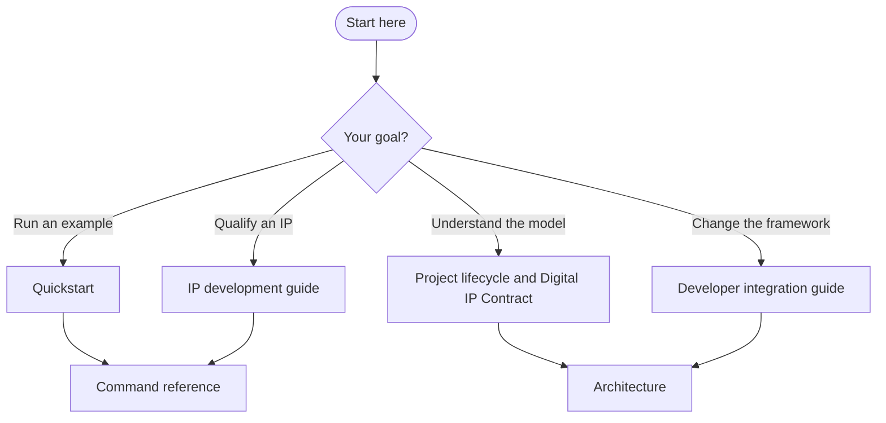

# FlexSoC Engineering Handbook

> **Start here.** This handbook documents the behavior of the repository at the time of each revision. Roadmap proposals are not evidence of implemented functionality.

FlexSoC is a **contract-driven digital hardware engineering and qualification framework**. It connects design intent, generated collateral, EDA execution, provenance, evidence and reusable release. The individual EDA tools remain authoritative for their analyses; FlexSoC is the coordination and traceability layer between them.

## Why FlexSoC?

| Engineering problem | FlexSoC approach | Read next |
| --- | --- | --- |
| Conflicting copies of design intent | Explicit ownership of authored inputs and generated outputs | [Architecture](architecture.md) |
| A passing result whose inputs have changed | Provenance-aware stage and evidence lifecycle | [Evidence ownership](architecture/evidence_ownership.md) |
| Repeating an entire flow after a small change | Contract dependencies and selective invalidation | [Project lifecycle](project_lifecycle.md) |
| Requirements disconnected from tests | CRS/TDS/requirements/testplan traceability and independently executed model checks | [IP traceability](methodology/ip_traceability.md) |
| Disconnected tool outputs and difficult release decisions | Traceable qualification evidence and Digital IP Contract | [Digital IP Contract](digital_ip_contract.md) |
| Undocumented command invocation | Explicit `fx` command interface and reproducible run configuration | [Command reference](command_reference.md) |

These are architectural mechanisms, not a claim that every proposed SoC qualification feature is complete. Check the command reference, implementation and actual run evidence for supported behavior.

## Choose your path

### Path A — First successful run

1. [Quickstart](quickstart.md): install, configure and execute a guided workflow.
2. [IP development guide](ip_development_guide.md): learn the complete engineering procedure.
3. [Command reference](command_reference.md): confirm exact options, commands and prerequisites.
4. [Docker/toolchain guide](../docker/README.md): understand reproducible tool dependencies.

### Path B — Understand the engineering model

1. [Project lifecycle](project_lifecycle.md): from authored intent to qualified release.
2. [Core concepts](concepts/README.md): ownership, evidence freshness, results and qualification.
3. [Digital IP Contract](digital_ip_contract.md): package, evidence, provenance and closure.
4. [Evidence ownership](architecture/evidence_ownership.md): ownership and lifecycle rules.
5. [Architecture](architecture.md): module boundaries and execution model.

### Path C — Develop or integrate FlexSoC

1. [Architecture](architecture.md): know the existing responsibilities.
2. [Developer integration guide](developer_integration_guide.md): extension points and implementation workflow.
3. [RTL schematic viewer architecture](architecture/rtl_schematic_viewer.md): viewer-specific semantics and limitations.
4. [Command reference](command_reference.md): validate behavior exposed to users.

## Where to go next

| Your question | Start with | Use for detail |
| --- | --- | --- |
| How does FlexSoC fit together? | [System architecture map](architecture/system-map.md) | [Architecture](architecture.md) |
| Which checks should I run? | [Choose a workflow](guides/choose-a-workflow.md) | [Practical guides](guides/README.md) |
| How do traceability, model tests and RTL regression differ? | [Quickstart — model and DV](quickstart.md#44-model-specification-traceability-and-rtl-regression) | [IP traceability](methodology/ip_traceability.md) |
| Why is a run missing, failed or stale? | [Read run results](guides/reading-run-results.md) | [Evidence lifecycle](concepts/evidence-lifecycle.md) |
| Which command and arguments do I need? | [CLI essentials](reference/cli-essentials.md) | [Command reference](command_reference.md) |
| What counts as IP/SoC qualification? | [Qualification boundaries](concepts/ip-soc-qualification.md) | [Digital IP Contract](digital_ip_contract.md) |
| How do ASIC stages relate? | [ASIC workflow navigator](guides/asic-flow-navigation.md) | [ASIC flow guide](flexsoc_asic_flow_guide.md) |

The [concept map](concepts/README.md) introduces terminology. The [reference desk](reference/README.md) routes detailed lookups without copying command definitions.

## Engineering workflows

| Activity | Guidance |
| --- | --- |
| IP implementation and qualification | [IP development](ip_development_guide.md) |
| Full ASIC-oriented flow | [ASIC flow guide](flexsoc_asic_flow_guide.md) |
| Multi-clock / CDC | [Clock-domain crossing](methodology/clock_domain_crossing.md) |
| Property and formal verification | [Formal verification](methodology/formal_verification.md) |
| Requirements and verification traceability | [IP traceability](methodology/ip_traceability.md) |
| Configuration authoring | [HJSON methodology](methodology/hjson.md) |
| Methodology index | [Methodology overview](methodology/README.md) |

## Trustworthy results

A tool's PASS alone is not a release decision. Verify the inputs, execution outcome, provenance, freshness and required qualification evidence. Follow the [evidence lifecycle](concepts/evidence-lifecycle.md) for the state model and [reading run results](guides/reading-run-results.md) for practical diagnosis.

## Documentation status and maintenance

- **Current implementation:** prefer commands, APIs and behavior verified in source and tests.
- **Planned design:** may appear in explicitly labeled direction documents, never as a verified workflow.
- **Historical investigation:** belongs in dated audit or decision records, not normal learning paths.
- Keep one authoritative page for each concept; link to it instead of repeating definitions.
- Keep historical design proposals separate from supported behavior. Verify procedures against the current CLI and implementation.

**Recommended reading:** start with [Quickstart](quickstart.md) for a first run, then use the [workflow guides](guides/README.md) for procedures. Consult the [reference](reference/README.md) for exact syntax. Historical records are deliberately excluded from normal learning paths.

