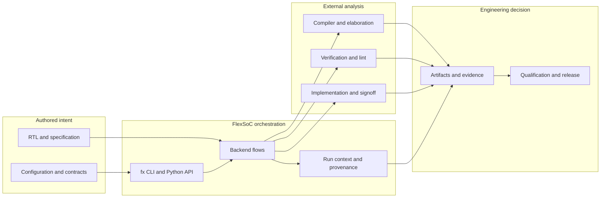
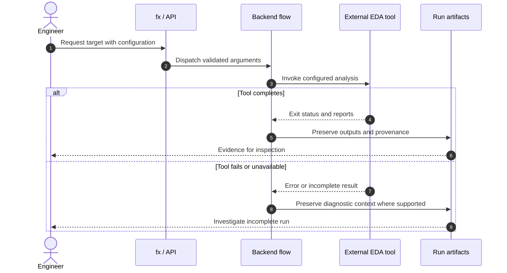
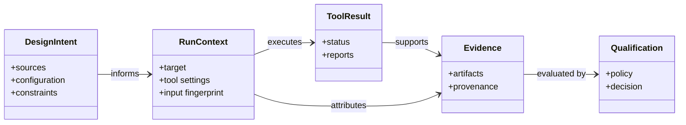

# FlexSoC system map

> **Purpose:** a reader-oriented conceptual map. The precise implementation and CLI surface remain documented in [Architecture](../architecture.md), [Command Reference](../command_reference.md), and source code. Diagrams below are explanatory, not an assertion that every integration is shipped.

## The core distinction

FlexSoC **coordinates and records engineering intent and evidence**; each EDA tool is authoritative for its own analysis. The central value is the relationship between authored inputs, the exact run configuration, retained outputs, and qualification decisions—not the mere ability to invoke an external binary.

This is a **responsibility map**, not a literal call graph. Some stages, tool integrations, and SoC-level lifecycle mechanisms are configuration-dependent or forward-looking. Inspect implementation and run evidence before claiming support.

## Separation of responsibilities

| Responsibility | Where to look | What must not be confused |
| --- | --- | --- |
| User commands and dispatch | [`src/flexsoc/cli.py`](../../src/flexsoc/cli.py), [`src/flexsoc/api.py`](../../src/flexsoc/api.py) | A registered target does not guarantee a successful run in every environment |
| Backend orchestration | [`src/flexsoc/backend/`](../../src/flexsoc/backend/) | Framework execution status vs EDA-tool result |
| RTL viewer and Slang-backed semantics | [Viewer architecture](rtl_schematic_viewer.md) | Displayed geometry vs proven connectivity |
| Ownership and provenance | [Evidence ownership](evidence_ownership.md) | Integrity vs freshness |
| Qualification policy | [Digital IP Contract](../digital_ip_contract.md) | Historical PASS vs accepted qualifying evidence |
| Operating procedures | [Workflow guides](../guides/README.md) | Conceptual model vs executable instructions |

## One run, several viewpoints

The message order is simplified to teach ownership; actual target-specific execution differs.

## How the pieces relate

These names are **conceptual entities**, not Python class names or a database schema. Read [Evidence lifecycle](../concepts/evidence-lifecycle.md) for the separate questions of existence, content integrity, currency and acceptability.

## Where to go next

- **First executable task:** [Quickstart](../quickstart.md)
- **Follow a real IP workflow:** [IP development guide](../ip_development_guide.md)
- **Diagnose questionable output:** [Read run results](../guides/reading-run-results.md)
- **Inspect actual interfaces:** [Command reference](../command_reference.md)
- **Contribute code:** [Developer integration guide](../developer_integration_guide.md)

## Qualification model and historical planning

For claim scope and evidence limitations see [IP/SoC qualification boundaries](../concepts/ip-soc-qualification.md). Earlier architecture aspirations are preserved separately in the [historical qualification direction](../history/ip-soc-qualification-direction.md); do not read them as shipped capabilities.
