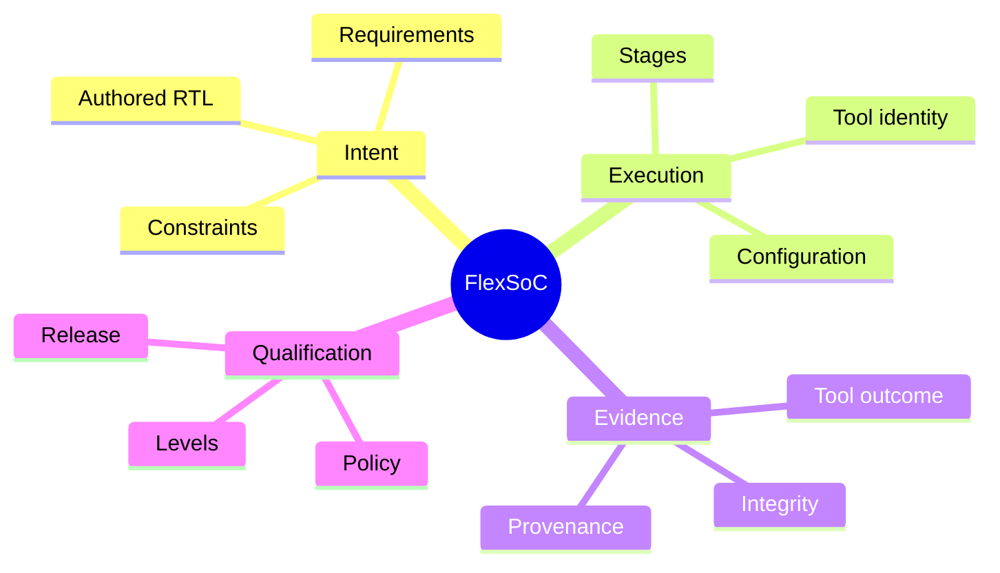

# Core concepts: understand before you qualify

**Audience:** engineers reviewing results, maintainers of lifecycle contracts, and authors of reusable IP releases.  
**Reading time:** approximately 10–15 minutes for this map and the evidence guide.

FlexSoC coordinates design intent and tool-produced evidence. The distinction between *what was run*, *whether it passed*, *whether its inputs are still current*, and *whether a release satisfies policy* is fundamental.

## The core questions

| Question | Authoritative discussion | Why it matters |
| --- | --- | --- |
| Which inputs are authored, and which outputs may be regenerated? | [Evidence ownership](../architecture/evidence_ownership.md) | Protect human-authored design intent. |
| What makes an artifact current after a change? | [Evidence lifecycle](evidence-lifecycle.md) and [Digital IP Contract](../digital_ip_contract.md) | Prevent reuse of outdated results. |
| What evidence is needed for an IP release? | [Digital IP Contract](../digital_ip_contract.md) | Separate tool PASS from qualification. |
| Which operations depend on which stages? | [Project lifecycle](../project_lifecycle.md) | Choose the correct re-execution path. |
| How do I inspect a suspect result? | [Inspecting run results](../guides/reading-run-results.md) | Locate missing, failed, or stale evidence. |

## Mental model

This mindmap is conceptual. The precise field names and supported states come from the [Digital IP Contract](../digital_ip_contract.md); do not treat this diagram as a data schema.

## Suggested reading order

1. Read [Evidence lifecycle](evidence-lifecycle.md) to distinguish the independent axes.
2. Follow [Inspecting run results](../guides/reading-run-results.md) for a decision-oriented diagnostic procedure.
3. Use the [Digital IP Contract](../digital_ip_contract.md) as the detailed specification.
4. Consult [Architecture](../architecture.md) when implementing or debugging the underlying behavior.

**Next:** [Evidence lifecycle](evidence-lifecycle.md).

## Qualification boundaries

[IP/SoC qualification model](ip-soc-qualification.md) explains what a result can and cannot establish, using mindmap, ER and decision-flow diagrams.
