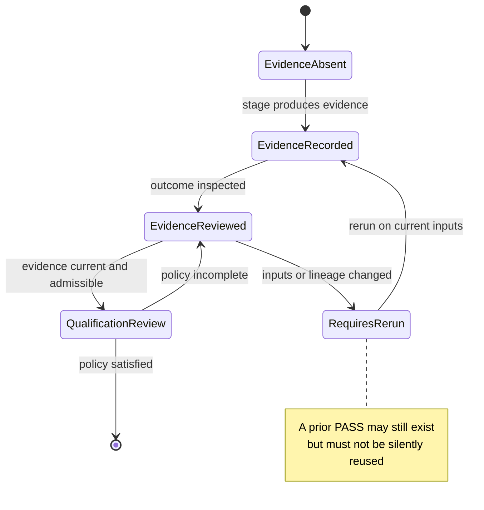
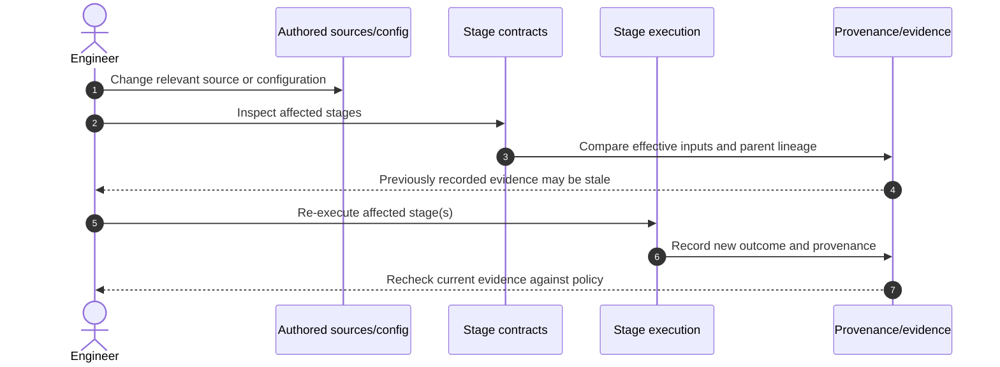
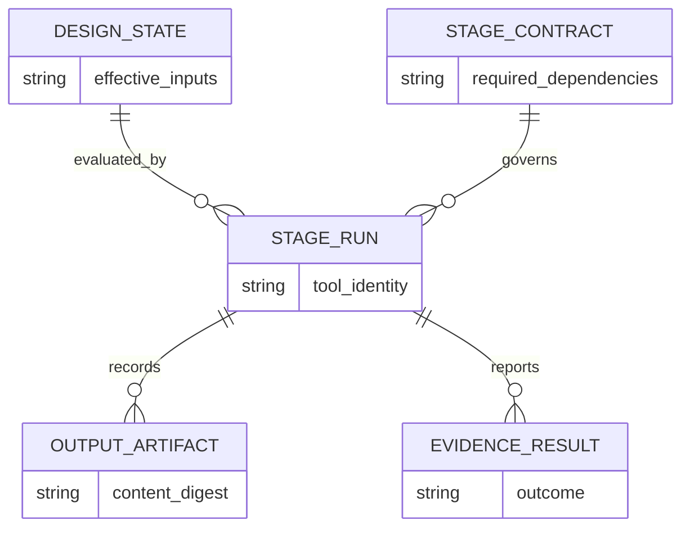

# Evidence lifecycle: integrity, freshness, outcome, qualification

**Audience:** RTL/DV engineers, IP release reviewers, and FlexSoC contributors.  
**Prerequisites:** [Core concepts](README.md).  
**After this page:** [Inspecting run results](../guides/reading-run-results.md).

## Why four questions must stay separate

A log containing `PASS` establishes neither the identity of the inputs used nor that the result remains applicable to the current design. Likewise, an unchanged output file does not prove that the underlying design satisfies an engineering requirement.

| Axis | Question | Where to verify |
| --- | --- | --- |
| Integrity and ownership | Are sealed files unchanged, and is an output producer recorded? | [Evidence ownership](../architecture/evidence_ownership.md) |
| Provenance freshness | Do effective inputs, dependencies, configuration and relevant tool identity still match? | [Digital IP Contract](../digital_ip_contract.md) |
| Tool/evidence outcome | Did the stage actually succeed, fail, require review, or receive a waiver? | Retained run outputs and lifecycle evidence |
| Qualification | Does *current, admissible* evidence satisfy the policy for the claimed level? | [Digital IP Contract](../digital_ip_contract.md) |

## Two lifecycle axes, not one status

The Digital IP Contract documents freshness states `MISSING`, `CLEAN`, `STALE`, `INVALID`, `MODIFIED`, `VALIDATED_OVERRIDE`, and evidence outcomes `MISSING`, `PASS`, `FAILED`, `REVIEW`, `WAIVED`, `STALE`, `INVALID`. These are **separate axes**. The following diagram is a **decision model**, not a literal implementation state machine:

Actual transitions depend on the stage and contracts. See the source of truth for authoritative status terminology.

## How stale evidence arises

The diagram explains responsibility boundaries; it is not a claim that every CLI command executes these exact calls.

## How artifacts relate to a result

This ER diagram is an explanatory logical relationship map, **not** the actual persisted JSON schema. Consult [Evidence ownership](../architecture/evidence_ownership.md) for exact integrity manifest fields and the [Digital IP Contract](../digital_ip_contract.md) for lifecycle terminology.

## Review scenarios

| Situation | Safe interpretation | Next action |
| --- | --- | --- |
| Tool log says PASS, RTL changed since that run | Historical success; current applicability unproven | Check freshness and rerun affected stages. |
| Generated output has changed without valid ownership | Integrity or ownership concern | Investigate producer/provenance; do not silently reseal. |
| Evidence is current, but outcome is FAILED | Current negative result | Debug the tool result; do not treat freshness as success. |
| Formal result WAIVED | Policy-dependent exception, not proof | Review waiver scope and release policy. |
| L3 evidence exists but claimed L5 | Higher physical/signoff closure not established | Check required technology-specific evidence. |

**Important:** L1–L5 are qualification levels, not interchangeable command exit codes. See [qualification levels](../digital_ip_contract.md#qualification-levels).
