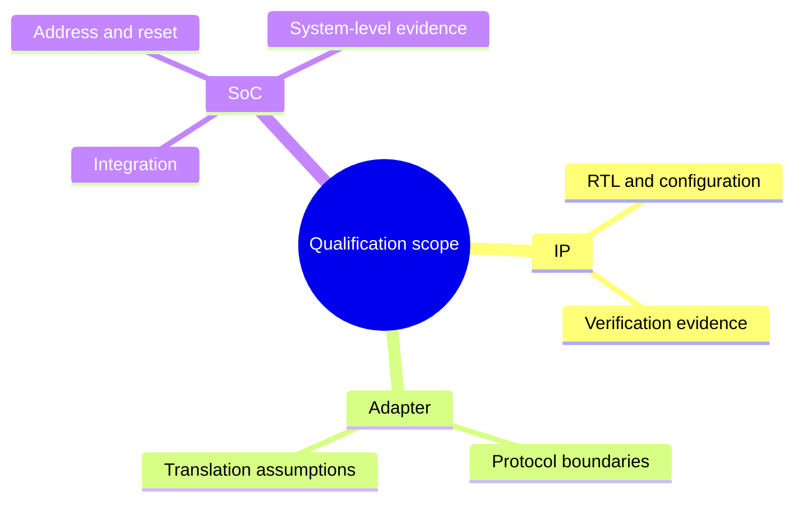
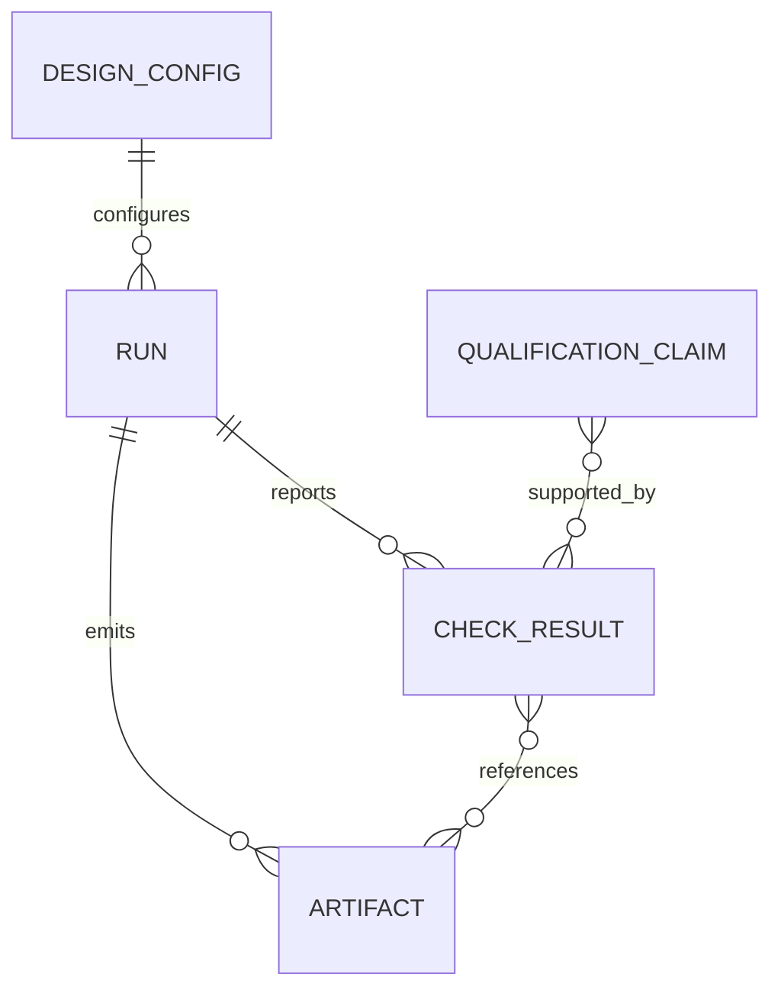
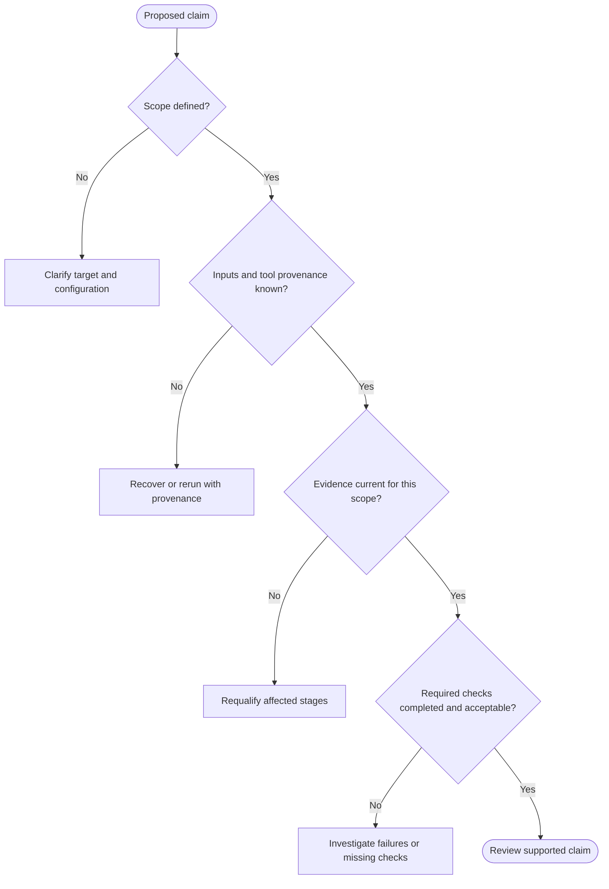

# IP and SoC qualification: boundaries and evidence

> **Conceptual model, not a feature availability matrix.** This chapter explains engineering decisions and vocabulary. Proposed CPU/transport integration paths in the [historical direction document](../history/ip-soc-qualification-direction.md) are not assertions of implemented features.

## Why this matters

A tool exit code or passing isolated test cannot establish that a reusable IP is suitable for every SoC. FlexSoC aims to make **the scope of each claim explicit**: what was built, with which inputs, under which conditions, and what evidence supports it. To understand operational behavior, continue with the [Digital IP Contract](../digital_ip_contract.md), [project lifecycle](../project_lifecycle.md), and [run investigation guide](../guides/reading-run-results.md).

## Understand the units of qualification

| Unit | Question | Required caution |
| --- | --- | --- |
| IP | What was checked for this component, with which sources and configuration? | IP evidence does not automatically prove SoC integration. |
| Adapter | What was checked about protocol translation and boundary behavior? | An adapter is its own verification target; compatible names are not proof of protocol compliance. |
| SoC composition | What integration, memory map, clocks, reset and system behavior have been checked together? | Reusing qualified blocks never substitutes for composition-level tests. |

## The evidence chain

The following **conceptual ER model** depicts traceability, not a claim about database tables or a particular serialization format.

A qualification claim needs a clearly defined **scope** and sufficient *current* evidence. Integrity (hash matches), provenance (which inputs/tool made it), result (what tool reported) and freshness (inputs still match) are distinct. See [evidence lifecycle](evidence-lifecycle.md).

## How to evaluate a qualification claim

This decision tree is a reading aid, not an executable implementation of the qualification policy. Check the actual project contracts for required checks and acceptance criteria.

## What is **not** implied

- A successful lint run does not prove system-level functional correctness.
- One passing IP run does not establish an adapter or SoC release.
- A hash match does not prove that the evidence is fresh or sufficient.
- A proposed CPU (Ibex/CVA6/VexRiscv), transport fabric (TL-UL/AXI/RegIface), or milestone in historical notes does **not** imply it has been shipped.
- A diagram describing a goal is not a test result.

## Read and do next

1. Read [project lifecycle](../project_lifecycle.md) to identify the actual engineering stages.
2. Check [Digital IP Contract](../digital_ip_contract.md) for package and evidence expectations.
3. Follow [inspect run results](../guides/reading-run-results.md) using an actual run directory.
4. Consult the [command reference](../command_reference.md) for supported CLI operations.
5. Use the [historical architecture direction](../history/ip-soc-qualification-direction.md) only when investigating rationale or future possibilities.
