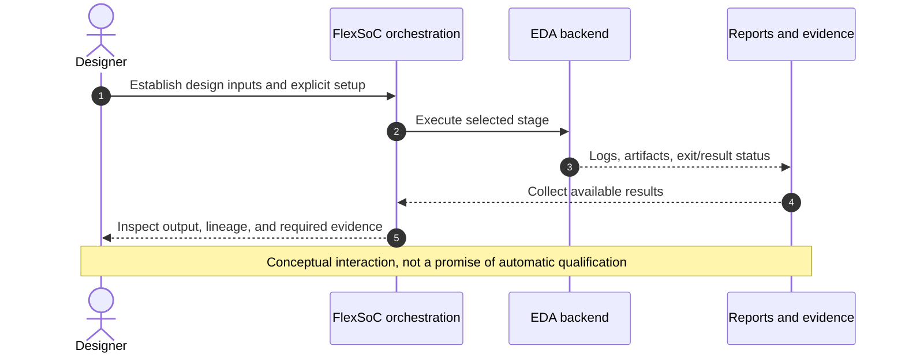
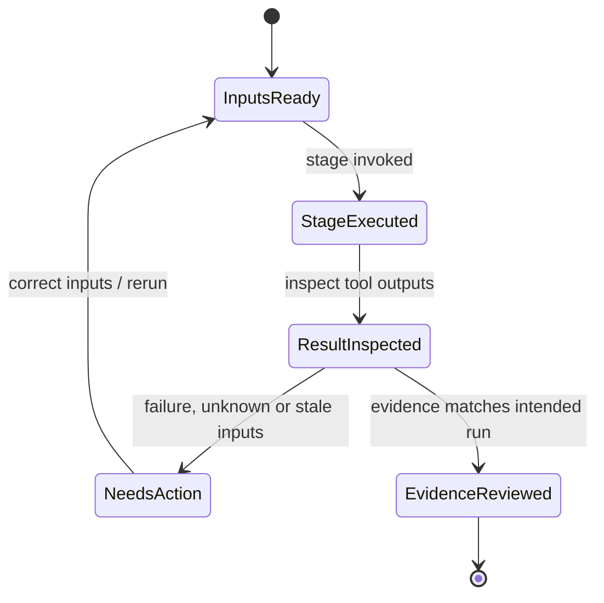

# ASIC workflow navigator: from intent to evidence

> **Scope:** this page indexes the existing ASIC guide. It does not assert that every backend, PDK, or sign-off stage is available in your installation. Check your checkout, selected PDK, configured tools and `fx commands --json` before running.

## Choose a phase

| Engineering intent | Read in the ASIC guide | Check next |
| --- | --- | --- |
| Establish design entry, files and constraints | [Sections 3–5](../flexsoc_asic_flow_guide.md#part-i--design-entry-and-generated-collateral) | Authored versus generated collateral |
| Lint, CDC/RDC, functional DV, formal | [Sections 6–9](../flexsoc_asic_flow_guide.md#part-ii--pre-synthesis-verification) | Run prerequisites and reports |
| Synthesize and establish equivalence | [Sections 10–12](../flexsoc_asic_flow_guide.md#part-iii--synthesis-and-logical-equivalence) | SDC intent and EQY status |
| Pre-implementation analyses | [Sections 13–17](../flexsoc_asic_flow_guide.md#part-iv--pre-implementation-sign-off) | Tool input revisions |
| Physical implementation | [Sections 18–19](../flexsoc_asic_flow_guide.md#part-v--physical-implementation-with-orfsopenroad) | PDK and implementation collateral |
| Post-implementation analysis | [Sections 20–24](../flexsoc_asic_flow_guide.md#part-vi--post-implementation-sign-off) | Routed artifacts and constraints |
| Physical sign-off and run qualification | [Sections 25–35](../flexsoc_asic_flow_guide.md#part-vii--physical-sign-off) | Required evidence and open limitations |
| DFT, SRAM, macro and full-chip plans | [Sections 36–43](../flexsoc_asic_flow_guide.md#part-x--roadmap-dft) | **Roadmap only**; do not assume availability |

[Guida in italiano](../flexsoc_asic_flow_guide_it.md) · [CLI command reference](../command_reference.md) · [Reading run results](reading-run-results.md)

## A staged engineering sequence

## Evidence boundaries

The state diagram is an **operator checklist**, not an implementation state machine. A completed stage is not equivalent to sign-off, and a green tool status is not proof of provenance freshness.

## Decide what to trust

1. Read the stage prerequisites and whether the intended setup was explicitly generated.
2. Confirm the tool actually ran, succeeded or failed, and emitted the expected artifacts.
3. Confirm source revision, settings, constraints, PDK and tool versions are consistent with the analysis.
4. Check whether the desired qualification requires additional independent stages.
5. If a stage is unavailable, record the gap; do not replace missing evidence with a downstream PASS.

To investigate a questionable result, start with [Reading run results](reading-run-results.md). For ownership and freshness, see [Evidence lifecycle](../concepts/evidence-lifecycle.md).
