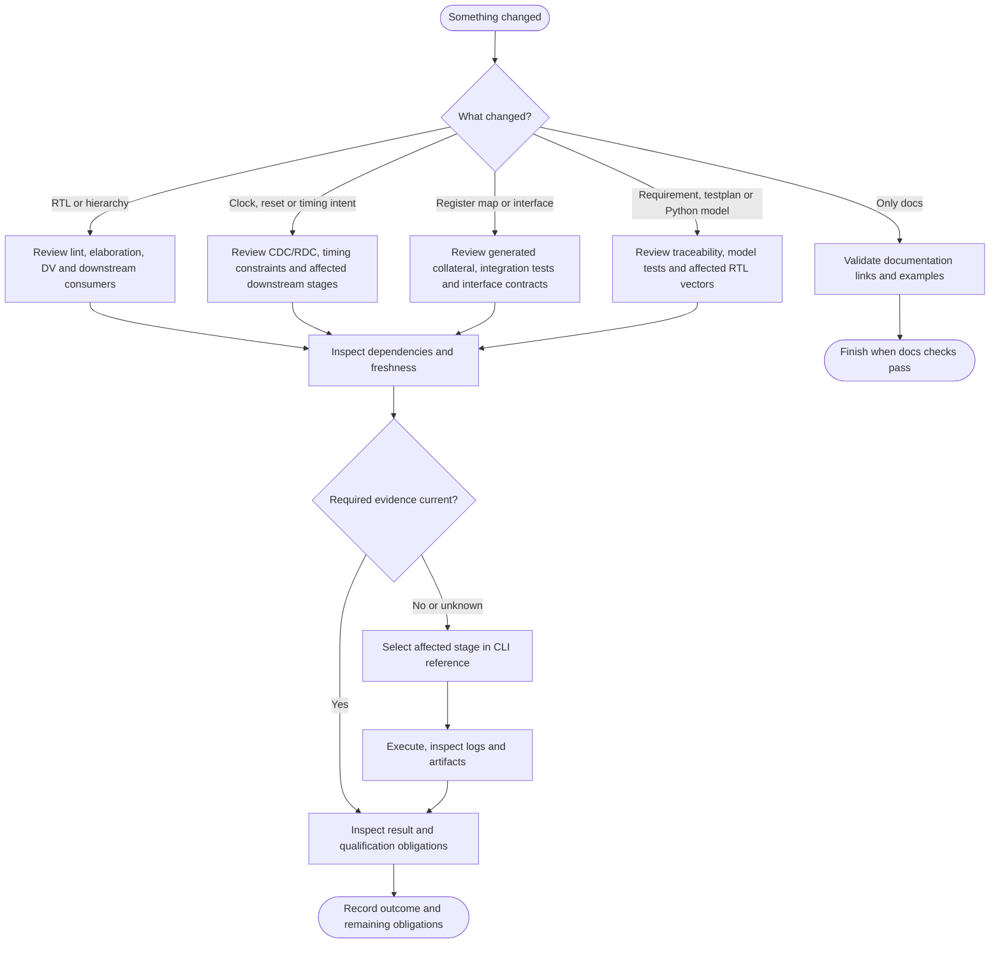
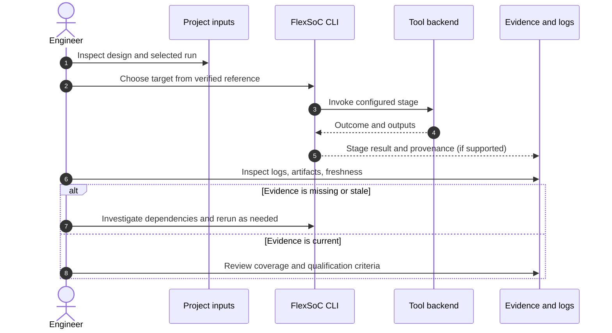

# Choose and verify an engineering workflow

**Purpose:** decide what to execute and what to inspect after a hardware or configuration change. This is a decision guide, not a replacement for tool-specific commands.

## Before you start

Confirm the design top, the selected project/run, source and constraint versions, available EDA tools, and the output directory. See the [quickstart](../quickstart.md) for environment setup and the [command reference](../command_reference.md) for exact syntax.

## Decide what needs new evidence

This is a conservative *investigation heuristic*, not a complete or automatic invalidation dependency graph. Use the actual [project lifecycle](../project_lifecycle.md) to determine stage dependencies. For changed requirements or model expectations, check `fx trace`, then execute `fx mtest` and/or `fx tests_gen` plus RTL regression as the impact requires. Model PASS never replaces RTL evidence.

## Follow the evidence, not just the exit code

This sequence is explanatory; stage implementations vary. Check exact output behavior in the backend and command reference.

## Checklist

- [ ] I identified the authored inputs and run configuration.
- [ ] I checked the **installed** `fx` interface rather than guessing command flags.
- [ ] I identified which stage results may depend on the changed input.
- [ ] I inspected the original tool log and output artifacts.
- [ ] I checked provenance/freshness independently from PASS/FAIL.
- [ ] I recorded missing evidence, remaining risks and next steps.

For diagnosis use [Reading run results](reading-run-results.md); for specific failure classes use the [failure-driven command playbook](../command_reference.md#8-failure-driven-command-playbook).
