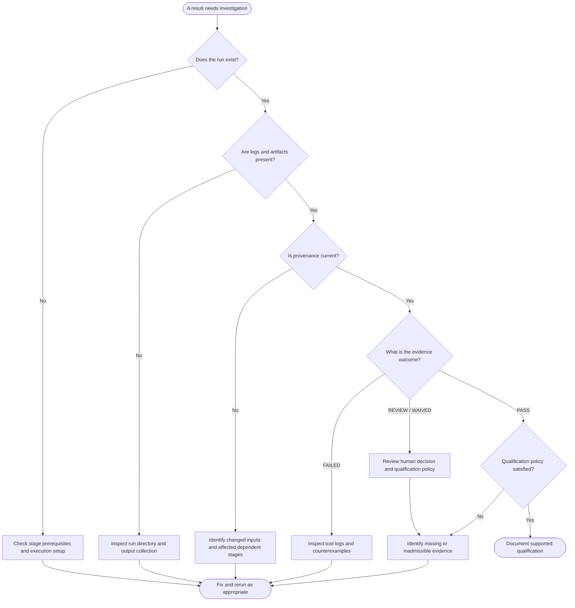

# How to inspect a questionable FlexSoC run

**Audience:** engineers investigating a failed, missing, outdated, or ambiguous result.  
**Prerequisites:** access to the relevant project/run artifacts and the tool installation required by the stage.  
**Related concepts:** [Evidence lifecycle](../concepts/evidence-lifecycle.md).

This is a **tool-independent inspection procedure**. It deliberately avoids assuming that a particular command or file path is universal across FlexSoC configurations. Confirm the exact CLI syntax in the [command reference](../command_reference.md).

## Diagnosis workflow

The conditions represent a review process, **not literal CLI prompts or a complete policy evaluator**.

## Checklist

1. **Identify the design state.** Record the top, sources/filelist, constraints, configuration and relevant tool/PDK selection used for the run.
2. **Find the exact run.** Locate its reported status, original tool output and any normalized evidence. Avoid relying on a copied terminal excerpt.
3. **Inspect freshness separately from outcome.** If effective inputs or dependency lineage changed, a historical PASS may no longer be admissible.
4. **Inspect original evidence.** Use the raw tool log, generated reports and appropriate failure artifacts (for example, formal counterexamples) to investigate why a stage failed.
5. **Check integrity and ownership.** Verify that protected authored inputs were not replaced and generated outputs have their expected producer lineage; see [Evidence ownership](../architecture/evidence_ownership.md).
6. **Review the qualification gate.** A stage success is not a release qualification. Determine which evidence is missing, stale, failed or policy-dependent.
7. **Re-execute only justified dependencies.** Use the stage contracts and [project lifecycle](../project_lifecycle.md) instead of assuming that every tool needs a full rerun.
8. **Record the final decision.** Capture the design identity, run reference, evidence and unresolved limitations.

## What to hand to another engineer

| Record | Minimum information |
| --- | --- |
| Design identity | Top, revision/inputs, configuration and relevant constraints |
| Execution context | Requested stage, relevant tool identity and technology context |
| Observed outcome | Exact status, not merely “looks green” |
| Supporting evidence | Paths or references to logs, reports, provenance and integrity records |
| Action taken | Rerun, investigation, accepted exception or escalation |
| Remaining uncertainty | Missing evidence, stale inputs or policy limitation |

## Further reading

- [Command reference](../command_reference.md) for exact supported commands.
- [Digital IP Contract](../digital_ip_contract.md) for status axes and qualification semantics.
- [Evidence ownership](../architecture/evidence_ownership.md) for sealed file integrity.
- [Project lifecycle](../project_lifecycle.md) for stage dependencies.
