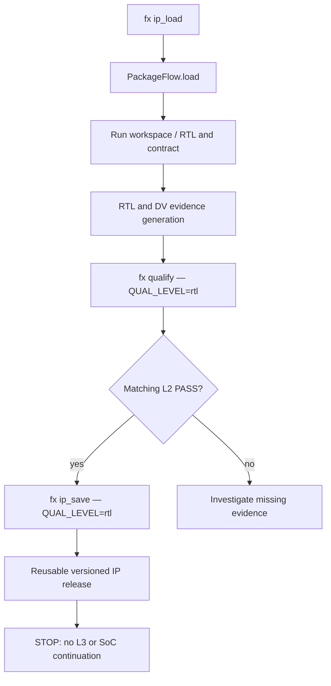
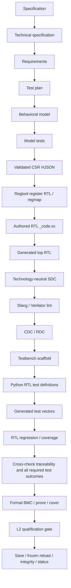

> **Historical engineering snapshot (2026-10-22).** This record documents an earlier repository assessment and pending work. It is **not** a current feature matrix, setup guide, or qualification claim. See [current handbook](../README.md), [architecture map](../architecture/system-map.md), and [command reference](../command_reference.md) for entry points. Validate any historical command against current implementation.

# FlexSoC — Backend audit and development roadmap

> Status: **initial evidence-based inventory** (2026-10-22). Not a completed end-to-end audit or L2 qualification run. This is a new planning/audit document; existing `docs/` content is unchanged.

## Scope and immediate priority

The initial IP validation matrix is:

| IP | Package version present | Interface in initial scope | Notes |
|---|---|---|---|
| `uart` | `1.0.0` | `tlul` | Full selected package / L2 flow |
| `gpio` | `1.0.0` | `tlul` | Full selected package / L2 flow |
| `rv_timer` | `1.0.0` | `tlul` | Full selected package / L2 flow |
| `uart_master` | `1.0.0` | `tlul` (`reg_itf`) | Only the TL-UL register interface; no other interface variants |
| `ethernet` | `0.1.0` | `tlul` | Only TL-UL interface; exclude full Ethernet functional closure for now |

`tlul` is the on-disk interface folder and `REG_ITF=tlul` is the CLI setting. Treat `reg_itf` as a reference to the register-interface selection, **not** as an alternative folder name in this scope. Avoid silently expanding UART/GPIO/timer scope to `reg_iface` or `axi_lite`. For the last two IPs, do not claim full functional L2 qualification when only interface-specific evidence has been exercised; identify any gaps in formal L2 policy.

## Repository snapshot / architecture AS-IS

Source: uploaded ZIP `flexsoc-main(20261022-193507).zip` copied into an isolated workspace. The archive does not include `.git` history. A new **local-only** Git baseline is used to track the inspection and documentation; its commit SHA is not the SHA of the user's repository.

| Component | Implementation entry | Observed responsibility |
|---|---|---|
| CLI | `src/flexsoc/cli.py` | `fx` / `flexsoc` commands and user options |
| API command registry | `src/flexsoc/api.py` | Targets, CLI-facing command descriptions and dispatch metadata |
| Backend context / orchestration | `src/flexsoc/backend/backend.py`, `backend/core/` | Backend wiring, runtime and flow target dispatch |
| Package load / save | `src/flexsoc/backend/release/package.py`, `PackageFlow` | Import frozen IP release or explicit requalification baseline, save release atomically |
| Qualification | `src/flexsoc/backend/release/qualification.py`, `QualificationFlow` | Levels, evidence and contract validation |
| RTL/IP construction | `src/flexsoc/backend/design/ip/` | IP-specific generation and artifacts; requires deeper call-graph audit |
| Lint / functional DV | `src/flexsoc/backend/dv/lint/`, `backend/dv/func/` | Lint and DV responsibilities; needs feature-level tracing |
| SoC flow | `src/flexsoc/backend/design/soc/` | SoC composition; out of current implementation boundary |
| Synthesis / signoff | `src/flexsoc/backend/syn/`, `backend/signoff/` | Later qualification levels; out of L2 release artifact requirement |

### Verified package-flow contract

`src/flexsoc/api.py` registers `ip_load`, `qualify`, `ip_save`, `lint`, `cdc_rdc`, `slang_hier`, and other targets. `PackageFlow.run()` dispatches `load` and `save`; `PackageFlow.load()` takes `ip_name`, `reg_interface`, optional `version`, `run_top`, `run_id`, workspace and an explicit `requalify` switch. For a normal load, it validates the frozen release; `requalify=True` stages a new *unqualified* source baseline and discards frozen evidence.

`QualificationFlow.normalize_qualification_level()` recognizes `rtl` as **L2** (`RTL Qualified`), distinct from contract L1 and netlist-based later stages. `PackageFlow.save()` accepts L2 without synthesis/netlist/signoff artifacts; it requires a matching PASS qualification report and checks the specification fingerprint. `tests/core/test_package_l2.py` contains save/reload and rejection tests. Therefore the planned flow should **reuse** this contract, rather than introduce a parallel concept of L2.

The diagram includes planned orchestration. It does **not** certify all its edges have passed end to end on the five selected IPs.

### Initial test baseline and issue

The initial command `pytest -q tests/core/test_package_l2.py tests/core/test_ip_requalification_load.py tests/regression/test_api.py -x` terminated at the first failure: **6 passed, 1 failed**. `test_requalification_load_is_explicit_and_unqualified[gpio]` expects a frozen-load error matching `IP-level spec fingerprint`, but `PackageFlow.load()` did **not** raise it. This is a baseline discrepancy; investigate whether the test expectation is obsolete or contract drift validation has regressed *before* changing either one. The `-x` flag means remaining tests were not executed in this run.

## Feature inventory — initial sample (expansion required)

| ID | Feature | Source | AS-IS evidence | Status |
|---|---|---|---|---|
| PKG-01 | IP package load | `PackageFlow.load`, API `ip_load` | Frozen load and explicit requalification paths | Implemented; regression investigation open |
| PKG-02 | L2 qualification | `QualificationFlow`, API `qualify` | `rtl` qualification alias and level report handling | Implemented; end-to-end coverage of selected IPs pending |
| PKG-03 | L2 package save | `PackageFlow.save`, API `ip_save` | L2 saves without netlist; report/fingerprint checks | Implemented; isolated tests present |
| PKG-04 | L2 package reload | `PackageFlow.load` | Core round-trip test present | Implemented; selected-IP tests pending |
| DV-01 | Lint | API `lint`, `backend/dv/lint/` | Slang/Verilator command description | Implemented; detailed warning taxonomy audit pending |
| DV-02 | CDC/RDC | API `cdc_rdc` | Structural check target exists | Implemented; behavior audit pending |
| RTL-01 | Hierarchy | API `slang_hier` | Slang hierarchy target exists | Implemented; behavior audit pending |
| SOC-01 | SoC composition | API `soc`, `backend/design/soc/` | SoC target exists | Outside current implementation scope |

## Gap list and acceptance tests for current L2 milestone

1. Resolve the GPIO requalification/fingerprint test discrepancy against the original package state (do not blindly relax integrity validation).
2. Establish non-destructive, per-IP runs for all five IPs, using unique `RUN_ID` and isolated `IP_LIBRARY_ROOT` for save tests.
3. Audit the precise evidence required by `QualificationFlow` for RTL L2, distinguishing complete IP qualification from restricted TL-UL interface work on `uart_master` and `ethernet`.
4. Run `ip_load` → required RTL checks/evidence → `qualify` at `QUAL_LEVEL=rtl` → `ip_save` at `QUAL_LEVEL=rtl`, using actual supported CLI flags.
5. Validate saved packages and perform a reload to a separate workspace; ensure the output has no inadvertent L3 synthesis/signoff dependency.
6. Capture tool versions, full commands, artifacts, pass/fail status and blockers. Mark **not run** or **blocked** where tools/evidence are unavailable.
7. Stop after saving/reloading L2; do not implement Interview or any later milestone.

## Future roadmap — TO-BE, not current implementation

1. **Interview**: reconstruct the current meaning and data contract, then implement only after the L2 milestone.
2. **Tool configuration**: more flexible tool registration / variables; evaluate GHDL for VHDL and mixed-language limitations.
3. **Lint views**: separate `common` / current IP; for SoC show SoC-specific, per-IP and shared/common warnings. Filter by tool, warning class, severity and independent remediation priority; apply consistently to `lint show` and subviews.
4. **RTL schematic viewer**: hierarchical lazy loading; collapse generated-instance stacks with shadows and optional explode; sequential boundary markers; CTRL signal-follow across hierarchy; from/to RTL logic cone; right-hand linked source pane for declarations, writes and reads.
5. **Analysis overlays**: lint, CDC and post-synthesis STA evidence with clear coordinate mapping.
6. **Synthesis schematic**: support flattened netlists with block grouping and disclose limitations in recovering RTL hierarchy.
7. **Full OOP refactor**: **later**, with characterization/regression tests and strict behavioral compatibility. Minimize *complexity*, not only line count; do not modify original project documentation yet.

## Open architectural questions

- Does the restricted TL-UL `uart_master` / `ethernet` scope satisfy the existing formal L2 policy, or require reporting a scoped partial qualification separate from an L2 PASS?
- Which source-of-truth fingerprints are expected to differ for GPIO on a frozen load? Is the failing test outdated or is contract validation too permissive?
- Which RTL, DV and formal external tools are available for end-to-end selected-IP runs?
- Which shared RTL and package boundaries should count as `common` for future lint views?

## Audit continuation

This document is an initial map and active issue register. It intentionally does not claim a completed backend/API/CLI symbol-by-symbol inventory, comprehensive tests, or a successful five-IP L2 flow. Expand it based on actual call traces and test evidence, preserving the AS-IS/TO-BE distinction.

## Verification update — 2026-10-24 (uploaded 2026-10-24 archive)

The current archive supersedes the earlier snapshot referred to above. A separate local Git baseline was created from the ZIP; it does not preserve upstream Git ancestry.

### Package/qualification characterization (AS-IS)

`PackageFlow.load` validates frozen releases via `QualificationFlow.validate_release_package`; `requalify=True` validates source-of-truth inputs but strips frozen qualification and stage artifacts. `PackageFlow.save` checks the matching L2 report, including identity, PDK, PASS status, spec fingerprint, and model-test evidence when required. These checks must not be bypassed for convenience.

The uploaded release set is heterogeneous, so `test_ip_requalification_load` now describes the observed contract explicitly:

| IP | Frozen `ip_load` | Explicit `requalify=True` |
|---|---|---|
| gpio 1.0.0 tlul | Loads successfully | Creates unqualified source baseline |
| rv_timer 1.0.0 tlul | Loads successfully | Creates unqualified source baseline |
| uart 1.0.0 tlul | Rejected: packaged RTL evidence/source inventory mismatch (contains workspace-derived path) | Creates unqualified source baseline |
| uart_master 1.0.0 tlul | Rejected: common specification fingerprint mismatch | Creates unqualified source baseline |

The previous test uniformly expected a spec-fingerprint error for all four IPs, contradicting the actual frozen release validation contract. The test has been corrected to characterize both valid and invalid cases, without changing production validation. Model tests are stored under `dv/functional/py/model/` for these test fixtures.

Executed commands:

- `pytest -q tests/core/test_package_l2.py tests/core/test_ip_requalification_load.py`: **33 passed**.
- `pytest -q tests/rtl_viewer`: **65 passed, 4 skipped**.

These are unit/integration tests in the available Python environment, **not** proof that a full EDA-backed L2 qualification ran for UART or Ethernet. The external EDA executables were not available in this workspace. No save/reload/status end-to-end qualification of a newly produced UART/Ethernet L2 release is claimed.

### CI image failure triage (AS-IS)

The logged failure occurs inside `install_sv2v` in `src/flexsoc/backend/core/runtime/deps.sh`, where a distro-provided `haskell-stack` calls `stack build --copy-bins` and Hackage TUF root verification fails. `GHC ... FP_PROG_LD_BUILD_ID` and `ar: conftest.a` occur earlier and are not the final terminating error. The mismatched stack/Cabal compatibility warning is worth checking separately. **Do not** disable Hackage signature verification or lower the signature threshold to make CI green. Preferred remediation for a dedicated follow-up change: pin a compatible, current Stack executable with a verified digest, test its Hackage root trust bootstrap in the Ubuntu 24.04 image, and retain reproducibility through the toolchain lock. Re-run a clean CI build (not only cached artifacts) before marking this fixed.

### Remaining milestone blockers (TO-BE)

1. Reconcile frozen UART provenance path mismatch against source inventory; do not rewrite valid history or ignore digest errors.
2. Reconcile the UART Master common-spec fingerprint mismatch, preserving the package contract.
3. Execute real `ip_load -> L2 evidence generation -> qualify -> ip_save -> reload -> check/status` for UART using installed EDA toolchain and a separate release root, recording each result.
4. Keep Ethernet interface-only tests distinctly scoped from full Ethernet RTL qualification.
5. Complete the backend/API/CLI call-graph inventory before any broad OOP refactor. RTL viewer has existing passing tests; no viewer behavior was changed in this increment.

## CI toolchain correction — base profile (2026-10-24)

The base dependency profile and CI command verifier no longer require sv2v or Haskell Stack. Slang and slang-hier remain mandatory and the existing viewer pipeline is unchanged. Legacy explicit sv2v installation and lock metadata are retained for compatibility; sv2v is not installed by the base profile. A real Docker image build was not possible in this workspace; dependency-plan tests and shell syntax checks were executed.

## Qualification L2 — ASIC-design order and lineage contract (2026-10-24)

### AS-IS verified in code and UART run log

- The run successfully produced lint, CDC/RDC, regression and formal evidence; `fx mtest` was executed **after** RTL regression.
- After `fx mtest`, `fx status` reported `model_tests=PASS` but `regression=STALE`. The RTL regression input snapshot used the **entire** `dv/functional/py` tree, including model-test result files written after regression. The regression ownership list also included the shared `dv/functional/summary.json` updated by the model-run evidence aggregator.
- `STAGE_CONTRACTS` covers tool execution/setup but is **not** yet the full upstream ASIC artifact graph (spec → implementation → DV). CLI commands can therefore be issued in an order that is not the intended design process.
- `QUAL_LEVEL=rtl` is logically pre-technology; the run status and qualification report are still displayed/stored with an active PDK identity. Technology-independent qualification must not depend on the chosen PDK, technology corners or synthesis libraries.

### TO-BE: required semantic execution graph (not yet implemented)

Edges represent mandatory upstream **closure prerequisites**; independent checks may execute in parallel after all their prerequisites are valid. Authored `_code.sv` is not overwritten by generated top or regtool RTL. For imported IP, source stages may be fulfilled by validated existing artifacts rather than newly generated artifacts. A detailed implementation of graph contracts must reflect actual producers/consumers and support these two modes without bypassing validation.

### Stage state versus stage result

| State | Meaning | Required action |
|---|---|---|
| `MISSING` | Artifact / provenance not produced | Build prerequisite then stage |
| `CLEAN` | Inputs, config, tool identity, parent fingerprints and generated outputs match | Reuse |
| `MODIFIED` | Generated output differs from recorded effective output while inputs remain current | Explicit review and validate or regenerate |
| `VALIDATED_OVERRIDE` | Reviewed generated edit matches accepted effective hash | Reuse with audit trail |
| `STALE` | Upstream input, config, tool identity, or parent lineage changed | Rebuild affected descendants, not unrelated stages |
| `INVALID` | Missing/corrupt required file or invalid provenance structure | Repair or regenerate; no PASS |

Runtime `PASS`, `FAILED`, `REVIEW` are **orthogonal** to these freshness states. A `PASS` with `STALE` provenance never qualifies. Shared dashboards, timestamps, logs and unrelated stage results must not enter input fingerprints unless the consuming tool truly uses them. Generated stage outputs must have a single authoritative owner; aggregate indexes are derived views, not evidence that a stage itself owns.

### Technology independence boundary

L2 consumes source RTL, logical clock/reset intent, generic SDC, lint, CDC/RDC, model verification, RTL tests, traceability and formal results. Do not fingerprint PDK choice, liberty, physical corners, floorplan or synthesis/PnR options into L2 closure. PDK selection is a downstream L3+ concern. The existing PDK-specific metadata placement and active-PDK display remain an **open migration**: preserve backward compatibility, do not silently rewrite release packages before a compatible schema/test strategy exists.

### Implemented in this increment

RTL regression now fingerprints Python RTL test generators rather than the complete `py/` tree, and no longer claims ownership of the shared functional summary. A regression test checks model-result isolation and true generator invalidation. This is a dependency-boundary correction, **not** completion of the end-to-end ASIC-stage graph or L2 qualification.

### L2 dependency graph guardrails (2026-10-24)

AS-IS: `StageContract.parents` specifies runtime/setup provenance prerequisites.
`StageGraph` now validates the existing declarations and resolves them into
stable prerequisite order. Missing parents, cycles and run-scoped stages that
require PDK-scoped parents are errors; technology-scoped stages may depend on
run-scoped stages. `TargetSession` uses this resolver instead of an unchecked
recursive traversal. This makes the **existing** dependencies safer; it does
not claim that the complete ASIC design sequence has already been encoded.

TO-BE: Represent spec, technical spec, requirements, testplan, model tests,
CSR HJSON/regtool, RTL/top/SDC generation, test definitions, traceability and
formal prerequisites using validated producer-owned inputs and artifacts.
Keep authored-source changes separate from generated-output edits. Ensure
qualification L2 requires only technology-independent stages, and verify
selective invalidation with tests that alter one input at a time.

### L2 dependency impact analysis (incremental milestone)

`StageGraph.affected(changed)` computes the transitive set of dependent stage
contracts in deterministic topological order. A changed model stage invalidates
its model tests and downstream consumers but not unrelated CSR/lint evidence;
a technology-specific stage cannot invalidate run-scoped RTL qualification.
The graph validates unknown names, missing prerequisites and cycles before
computing impact. This is a **planning and validation primitive**, not yet an
automatic file-to-stage mapping or complete ASIC phase orchestration. The
source ownership and provenance of spec, technical specification, requirements,
testplan, HJSON/regtool, RTL/top/SDC, Python tests and traceability still need
explicit contracts before full L2 can be declared end-to-end complete.

### Distinct behavioral and RTL verification gates (incremental milestone)

`StageContract.parents` represents **provenance-consuming** dependencies: when
an input changes, `StageGraph.affected()` propagates staleness through those
edges. New optional `StageContract.gates` names **execution/qualification**
prerequisites only: `StageGraph.prerequisites()` validates them, orders them and
rejects PDK-specific prerequisites for technology-independent stages, but a
gate changing does not overwrite or stale otherwise independent test evidence.
Both kinds of dependency participate in cycle validation.

Behavioral-model tests and RTL regression have independent evidence. The model
test plan covers behavioral obligations; RTL verification covers behavioral plus
cycle-accurate, CSR and protocol obligations. The intended closeout order is
model verification, RTL creation, SDC/lint/CDC-RDC, RTL regression,
traceability, formal and L2. These ordering relationships are gates where the
stage does not consume the other stage's artifacts. Tests illustrate the intended
DAG without hardcoding fictitious production contracts.

**Not yet wired:** the complete spec-to-L2 stage graph, executable CLI order,
source-to-stage fingerprint mapping, tech-independent L2 persistence and UART
save/reload/check round trip. This change only makes the existing graph capable
of representing those dependencies correctly. No EDA end-to-end validation has
been performed for this increment.

### 2026-10-24 — Partial requirement coverage, evidence truthfulness

The spec validator now preserves unplanned baselined requirement IDs in
`uncovered_requirements`; missing test-plan links are no longer a malformed
specification. The extended CRS/TDS mapping similarly records
`unplanned_requirements` as `PARTIAL`. L2 is **not** silently certified:
`requirements_coverage` explicitly blocks L2 until the missing coverage is
closed. This is a first step toward a separately defined audited conditional
qualification (not implemented). No partial coverage is reclassified PASS.

Baseline warning: running the broader `test_functional_python_contract.py`
suite on this ZIP yields missing `scenarios.py` and `*_model{,_tests}.py`
under packaged interface directories (20 failed, 113 passed, 4 skipped in
that selected run). These are not fixed by inventing behavioral models.
The real Slang generate-instance collisions reported on the user's host also
remain a separate schematic-viewer issue (Slang absent here).

### Iteration: model/RTL source boundaries and partial coverage development gate (2026-10-24)

**AS-IS confirmed:** bundled GPIO, UART, RV Timer and UART Master interfaces
store the independent Python behavioral models and known-answer tests in
`dv/functional/py/model/`, whereas RTL vector and CSR generators live in
`dv/functional/py/rtl/`. Older functional-contract tests expected all those
files directly in `py/`, and therefore reported false missing-source errors.
Their assertions now describe the actual split; no generated model assertions
or release artifacts were fabricated.

**Policy:** uncovered requirements are exposed as `requirements_coverage=REVIEW`
and remain listed by identifier. L2 stays `BLOCKED` and `target_satisfied=false`.
An explicitly fingerprint-bound, owned, reasoned and dated engineering deferral
can mark the *development* readiness as `CONDITIONAL` when no other issues
remain. This is not `L2 PASS`, does not create verification evidence, and must
not authorize an unqualified sealed release. The existing `fx defer` command
can record this gate just like other missing evidence.

**Tests run:** 42 qualification/graph/package regression tests passed;
10/10 actual bundled model regression variants passed; 10/10 IP vector
contract variants passed. No full UART toolchain L2 end-to-end or package
save/reload was executed in this isolated environment, and no production
Slang/Verilator qualification result is inferred from these Python tests.

**TO-BE remaining:** establish explicit documented conditional release policy,
complete full AS-IS stage-artifact dependency registration, run physical EDA
verification for RTL/fomal/CDC, verify UART L2 save/reload/check, then revisit
viewer elaboration generate-instance paths independently of qualification.
