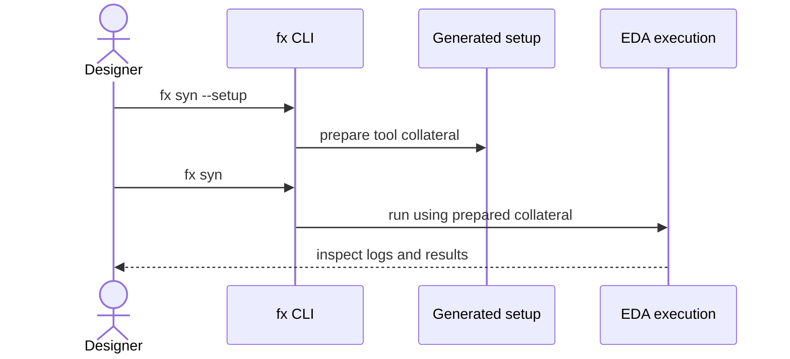

# CLI essentials — first find the right command

This is a **short entry point**, not a second command specification. The canonical details remain in the [full command reference](../command_reference.md). The examples below were checked against the `FLOW_GUIDE`, `PSEUDO_COMMANDS` and option declarations in `src/flexsoc/cli.py` from the supplied source archive; they have **not** been executed against an installed toolchain.

## The mental model

The diagram illustrates the documented setup/run split using synthesis. It does not mean that every target has a `--setup` mode.

## Find out what your checkout supports

| Goal | Command | Interpretation |
| --- | --- | --- |
| Browse entry-point help | `fx --help` | Human-oriented CLI help |
| Discover targets | `fx commands` | Target names and descriptions |
| Inspect machine-readable metadata | `fx commands --json` | Useful for integration scripts |
| Inspect one target | `fx lint --help` | Read the target's actual options |
| Check local dependencies | `fx doctor` | Tool availability and environment diagnostics |
| Inspect run settings | `fx settings` | Persistent configuration for this workspace |
| Preview a target without running | `fx syn --dry-run` | Inspect the command, not its execution result |

## Typical starting points

| You need to… | Begin with | Continue with |
| --- | --- | --- |
| Initialize a new IP | `fx setup --force` | [Quickstart](../quickstart.md) |
| Create or refresh CSR collateral | `fx hjson --force` | [HJSON methodology](../methodology/hjson.md) |
| Run RTL lint | `fx lint` | [Workflow selection](../guides/choose-a-workflow.md) |
| Inspect RTL hierarchy | `fx slang_hier` | [Viewer architecture](../architecture/rtl_schematic_viewer.md) |
| Open RTL viewing | `fx rtl-view` | [Viewer architecture](../architecture/rtl_schematic_viewer.md) |
| Prepare synthesis | `fx syn --setup` | [ASIC navigator](../guides/asic-flow-navigation.md) |
| Execute prepared synthesis | `fx syn` | [Run-result diagnosis](../guides/reading-run-results.md) |

**Read before running:** `--force` may regenerate machine-owned collateral. Inspect the [ownership contract](../architecture/evidence_ownership.md) and your checkout's specific command help before using it on an existing design. EDA stages may require tools, PDKs, source lists, and earlier setup.

## If something fails

1. Inspect the exact CLI invocation and its exit status.
2. Check prerequisites and configuration with `fx doctor`, `fx settings` and the target's `--help`.
3. Read the raw tool log and relevant generated artifacts.
4. Compare run inputs and provenance with the active design before trusting results.
5. Follow [Reading run results](../guides/reading-run-results.md) for missing, failed or stale evidence.

For variable names, backend target catalogue, ownership and lifecycle sequences, consult the [full reference](../command_reference.md). Do not infer that a documented command guarantees an installed backend or a passing result.
